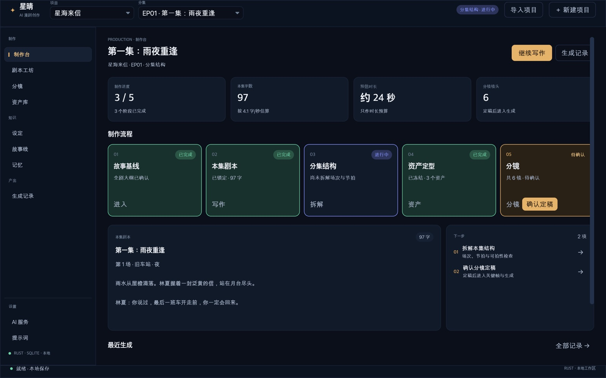
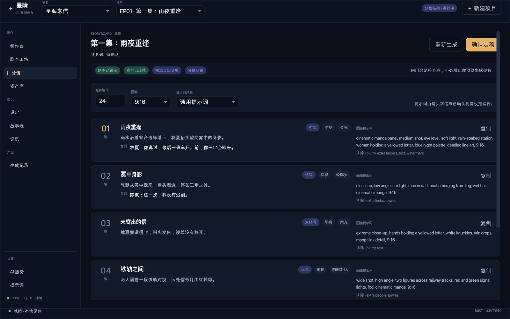

# 星晴 · AI Comic Tool

面向 macOS 与 Windows 的原生 Rust 漫剧创作桌面应用。界面使用 Iced，项目与记忆保存在本机 SQLite；AI 请求由 Rust 直接调用 Google Gemini 原生接口或可配置的 OpenAI 兼容服务。

本次重设计把原来的并列工具页重组为一条以"集"为单位的制作线：故事基线 → 本集剧本 → 分集结构 → 资产定型 → 分镜，每阶段有真实产物与人工闸门。设计依据与界面规格见[工作流与界面重设计](docs/design/星晴工作流与界面设计.md)。

发布程序不需要 Python、Node、npm、WebView、Tauri 或本地 API 服务。源码构建使用 Cargo 和平台编译工具；本地大模型权重不包含在安装包中。

当前可使用项目/分集编辑、制作台阶段与闸门、剧本优化、结构拆解与资产提取、分镜生成与镜头表、可缩放画布、事件矩阵、素材库、项目上下文、Prompt 模板、运行审计和记忆审核。关键帧、视频、TTS、字幕与合成属于后续阶段，界面中标记为规划，不冒充已交付能力。迁移保留创作流程，但并非旧版的逐像素复刻或全部接口的界面化；具体差异见 [迁移对照](docs/archive/rust-migration.md)。

生成结果、运行详情与记忆按字段标题、列表编号和层级缩进展示，保留正文换行；画布预览按文字宽度折行，完整内容可在详情查看。项目上下文通过分组表单编辑，支持添加、删除字段和列表条目；无须编辑 JSON，底层数据与原始运行记录保持兼容。

## 新机器快速开始

需要 Rust 1.88 起；macOS 安装 Xcode Command Line Tools，Windows 安装 MSVC C++ Build Tools 与 Windows SDK。

```sh
git clone https://github.com/linbark/aicomic-tool.git
cd aicomic-tool
cargo run --locked -p aicomic-desktop -- --data-dir "./demo-data" --demo
```

首次启动会创建独立数据目录并写入演示项目，不联网、不请求模型。稳定构建：

```sh
cargo build --locked --release -p aicomic-desktop
./target/release/aicomic-tool
```

Windows 使用 `target\release\aicomic-tool.exe`。

仓库只包含源码、内置 Prompt 与演示截图，**不包含数据库、项目素材、模型权重或 API Key**。要把现有项目带到另一台电脑，请复制整个应用数据根目录（`database.db`、`memory_store.db`、`projects/`、`data/`、`ai_settings.json` 等），再用 `--data-dir` 指向它；私有仓库也不建议提交密钥。

## 项目导入与导出

制作台底部的“项目管理”提供“导出项目”，顶栏和首次启动页提供“导入项目”。导出文件是一个 `.xqproj` 单文件，内部包含：

- 项目信息、分集、剧本与 `exec_artifacts`
- 场景、镜头、镜头选中素材
- 资产条目、资产素材文件、头像与收藏状态
- 事件与事件场景关联
- 项目设定、项目大纲、Visual DNA 与制作闸门状态

不包含：运行历史（`projects/<id>/runs`）、记忆数据库、AI 设置与密钥、模型权重、全局 Prompt 模板。导入是新增项目，不覆盖现有项目；同名项目会加“（导入）”后缀，并重新分配数据库 ID、素材路径与闸门中的分集 ID。

命令行也可用于迁移或备份：

```sh
cargo run --locked -p aicomic-desktop -- --data-dir "./data" \
  --export-project 1 --export-output "./蛊真人.xqproj"

cargo run --locked -p aicomic-desktop -- --data-dir "./data" \
  --import-project "./蛊真人.xqproj"
```

## 制作工作流与界面

设计文档把制作拆成五个已实现阶段，并在需要人确认的地方设置闸门：

| 阶段 | 产物 | 闸门 |
| --- | --- | --- |
| 故事基线 | 故事设定、项目大纲 | 大纲确认 |
| 本集剧本 | 可拍剧本、优化稿 | 剧本锁定 |
| 分集结构 | 分集大纲 / 节拍表 | 结构确认 |
| 资产定型 | 角色、场景、道具与视觉设定 | 资产冻结 |
| 分镜 | 景别、角度、光线、动作、台词与提示词 | 分镜定稿 |

制作台展示真实状态与下一步；剧本工坊保留正文、AI 工坊与结构/资产画布；分镜页生成并检查镜头行，支持复制提示词与定稿；资产库管理角色/场景/道具、素材和冻结状态。所有生成工作流的按钮先进入"生成前确认"，展示目标、模型、输入规模、最大输出与 Run 标识，确认后才发起请求。闸门保存在项目上下文 `production_state.v1`，不改变旧 SQLite 表结构。





## 开发与测试

需要 Rust 工具链，以及 macOS 的 Xcode Command Line Tools，或 Windows 的 MSVC C++ Build Tools 与 Windows SDK。workspace 声明 Rust 1.88 起，依赖版本以提交的 `Cargo.lock` 为准。

先使用独立目录预览，避免修改原工作区：

```sh
cargo run --locked -p aicomic-desktop -- --data-dir "./demo-data" --demo
```

`--demo` 仅在空库中创建演示内容，不下载模型或请求 AI。开发与验收可用 `--page workbench|script|storyboard|assets|context|events|memory|runs|ai|prompts` 指定启动页面，`--step 1|2` 查看剧本工坊的结构/资产画布，`--preview ACTION` 直接打开生成前确认，`--ime-log` 在终端打印输入法事件。以上只改变初始视图或诊断输出，不发起生成请求。常用检查：

```sh
cargo fmt --all -- --check
cargo test --locked --workspace --all-targets
cargo clippy --locked --workspace --all-targets -- -D warnings
cargo build --locked --release -p aicomic-desktop
```

release 可执行文件位于 `target/release/aicomic-tool`，Windows 为 `aicomic-tool.exe`。窗口冒烟检查会打开真实桌面窗口，需要图形会话：

```sh
cargo run --locked --release -p aicomic-desktop -- --data-dir "./smoke-data" --demo --smoke-test
```

自动化测试使用临时数据库、本地模拟 HTTP 和微型推理权重；它们不等于真实付费模型、完整 BGE-M3 或每个平台的人工验收。

## 旧数据与备份

`--data-dir` 指向**应用数据根目录**，其中应包含 `database.db`，以及同级的 `data/`、`projects/` 等内容；不要把它指向旧 `AICOMIC_DATA_DIR` 对应的素材 `data/` 子目录。

```text
应用数据根/
├── database.db                 # 项目、分集、资产、事件等
├── memory_store.db             # 记忆事实、证据、审核及原生向量缓存
├── ai_settings.json
├── embedding_settings.json
├── prompt_templates.json
├── data/                       # 相对路径素材
├── projects/<数字项目ID>/
│   ├── context/
│   └── runs/
└── backups/
```

首次复用旧数据前，关闭旧版与新版应用，复制整个根目录作为备份，再对副本运行：

```sh
cargo run --locked -p aicomic-desktop -- --data-dir "/path/to/copied-app-data"
```

Windows 可将路径替换为 `"C:\path\to\copied-app-data"`。也可使用环境变量 `AICOMIC_APP_DIR`；命令行参数优先。未指定时默认位置为：

- macOS：`~/Library/Application Support/com.ljc.aicomictool`
- Windows：`%APPDATA%\com.ljc.aicomictool`

主数据库确需结构迁移时，会先通过 SQLite 备份 API 写入 `backups/database-before-rust-*.db`。这只覆盖主库迁移，不是素材、记忆库或设置的整目录备份。恢复时先关闭应用，并使用一致的整套备份；AI/Embedding 设置可能含密钥，应按私密数据保存。外置模型目录也需单独保管。

旧项目数字主键、UUID、Context/Run 文件与相对素材路径继续使用；旧 Qdrant 目录不会直接作为 Rust 向量引擎打开。请保留它作为历史数据，原生语义索引从 SQLite 事实重建。

## AI 与记忆模型

在“AI 设置”填写服务地址和 API Key，从模型目录搜索、选择模型，保存后可主动点击“测试连接”。剧本生成、项目大纲、Visual DNA 和 HTTP Embedding 会访问所配置的远程服务；普通编辑、素材管理及事实浏览不需要这些服务。

接入 Google AI 时，在“模型服务”选择 **Google AI / Gemini**，填写自己的 API Key 并保存。默认服务地址为 `https://generativelanguage.googleapis.com/v1beta`，默认模型为 `gemini-flash-latest`；模型名可修改。Rust 使用 `generateContent` 和 `x-goog-api-key` 请求头，直接接入 [Gemini 原生接口](https://ai.google.dev/api/generate-content)。切换模型服务会重置地址和模型并清空旧密钥，避免将另一服务的密钥发送出去；未包含服务类型的旧配置继续按 OpenAI 兼容接口读取。密钥只保存在本机设置文件，不应提交或分享。

点击“获取模型列表”可读取当前服务的模型目录，在可搜索的下拉列表中选择后保存。Google 使用 [`models.list`](https://ai.google.dev/api/models#method:-models.list)，会读取全部分页；OpenAI 兼容服务使用 [`/v1/models`](https://developers.openai.com/api/reference/resources/models/methods/list)。列表显示服务返回的全部模型；Google 未声明支持 `generateContent` 的模型会标为不适用于当前创作，不能从列表激活。支持该接口也不代表模型一定支持当前文本参数、账户权限或付费额度。OpenAI 兼容目录通常不含能力信息，具体兼容性以实际请求结果为准。

获取目录不会修改当前模型，也不会请求生成内容。模型仅通过目录搜索、选择，当前已保存模型保留显示；目录获取失败时可重试，仍可保存其他设置。切换服务、地址或密钥会清除旧目录并忽略旧请求结果；应用启动不会自动联网获取列表。

“测试连接”仅发送简短测试提示，不发送项目内容；Google 的测试输出额度为 1024 tokens，以容纳模型的思考过程。此接入覆盖现有文本创作流程；记忆 Embedding 仍使用下述独立配置。

记忆 Embedding 默认 `disabled`，仍可查看原文、词面检索、使用结构化记忆上下文及审核变更。启用语义检索有两种方式：

- `http`：配置 OpenAI 兼容 Embedding 服务。
- `local`：指定兼容 XLM-RoBERTa/BGE-M3 的模型目录，包含 `config.json`、`tokenizer.json`、`model.safetensors`。Rust/Candle 在 CPU 上执行，不自动下载或转换模型。

保存模型配置后，在“记忆”页显式重建已有事实的语义索引；更换模型身份或向量维度后也需要重建。索引就绪后，后续任务检索可增量更新变更的事实。原生缓存使用 SQLite 密集向量与精确余弦扫描，不承诺旧 Qdrant HNSW 的大规模性能。

完整 BGE-M3 权重的准确率、峰值内存和 CPU 速度尚未完成实测。现有推理测试验证的是微型 XLM-RoBERTa 权重的真实 Rust 张量路径；较大的 safetensors 会占用更多内存。详见 [记忆模块](crates/aicomic-memory/README.md)。

Visual DNA 当前保留原版文本接口的能力限制：按文件名、资产描述和已知上下文推断，不读取图片像素，不应当作已验证的图像识别。

## 桌面打包与验证状态

macOS 在对应平台构建 `.app`、应用 ZIP 和 DMG：

```sh
bash packaging/macos/package.sh --target aarch64-apple-darwin
bash packaging/macos/package.sh --target x86_64-apple-darwin
```

需要对应 Rust target 和原生构建环境，默认部署目标为 macOS 13。输出分别位于 `dist/macos-arm64/` 和 `dist/macos-x64/`。

Windows x64 在 Windows PowerShell 中安装 Rust MSVC 工具链与 NSIS 3 后运行：

```powershell
./packaging/windows/package.ps1
```

输出 `dist/windows-x64/` 下的独立 EXE 与当前用户安装器；卸载保留应用数据。详细参数见 [打包说明](packaging/README.md)。

| 目标 | 当前证据与边界 |
| --- | --- |
| macOS arm64 | release、APP/ZIP/DMG 及校验通过；在 macOS 27 实测中文编辑、保存快捷键、切集、事件矩阵选择/缩放、系统素材导入和图片预览。不是所有交互或最低系统版本的完整验收 |
| macOS Intel x64 | 本机交叉编译与 APP/ZIP/DMG 打包通过；Rosetta 隔离启动检查退出 0，尚无 Intel 硬件实测 |
| Windows x64 | 已配置原生 CI、EXE/NSIS 打包及安装/卸载检查；本次尚未在 Windows 实际运行 |
| 签名 | macOS 仅 ad-hoc 签名，无 Developer ID 签名或 Apple 公证；Windows EXE/安装器未签名 |

CI 配置见 [rust-desktop.yml](.github/workflows/rust-desktop.yml)；配置存在不代表运行成功。最低 macOS 版本配置也不代表已在该版本实测。音频、视频和文档目前通过系统默认应用打开，图片可在素材库内预览。

2026-11-09 本机检查：178 项测试通过（AI 48、存储 25、桌面与集成 75、记忆 30），workspace 格式与严格 Clippy 检查通过。新增制作台阶段推导、闸门持久化/拒绝、生成前确认/取消/切换丢弃/输入变更重确认、分镜输入上下文、长剧本编辑高度，以及项目归档导出/导入的媒体、素材、事件与闸门 ID 重写回归验证；原生窗口截图覆盖制作台、剧本、分镜、资产、设定、记录、提示词、生成前确认与引导页。中文输入法仍未由自动化代替人工验收，步骤见设计文档附录 B。此前 Google 原生连接探测实际返回“连接成功”，只发送简短测试文字；旧数据副本启动后，项目/分集数量保持一致，主库与记忆库完整性检查通过。具体范围见 [验证证据](docs/archive/rust-migration.md#构建发布与验证证据)。

## 源码布局

```text
crates/
  aicomic-core/       # SQLite 兼容迁移、项目/资产/事件与文件
  aicomic-ai/         # 模型客户端、Prompt、Context/Run、工作流与审核恢复
  aicomic-memory/     # 事实、证据、变更审核、检索与可选 Rust 推理
  aicomic-desktop/    # Iced 窗口、制作台、编辑器、画布与应用集成
packaging/           # 独立图标、macOS 与 Windows 打包脚本
docs/design/         # 漫剧工作流研究、界面设计、截图与文档索引
docs/archive/        # 归档资料（含迁移说明与历史设计研究）
```

旧 Python/React/Tauri 源码与过时工具配置已从当前工作树移除，可从 Git 历史追溯。当前能力、已知差异和验收范围以 [Rust 迁移说明](docs/archive/rust-migration.md) 为准。

## 领域设计资料

当前设计：

- [文档索引](docs/design/README.md)
- [星晴工作流与界面设计](docs/design/星晴工作流与界面设计.md) —— 五阶段制作线、闸门、信息架构、页面规格、视觉系统与实现边界
- [漫剧开源工作流研究](docs/design/漫剧开源工作流研究.md) —— 开源项目、小说转剧本、分镜与运镜、素材一致性、视频生成、配音、监控干预与批量生产

历史归档（详见[归档说明](docs/archive/README.md)；设计研究类文档不代表当前实现状态）：

- [Rust 迁移说明](docs/archive/rust-migration.md)（迁移能力与验收范围的权威记录；界面入口以设计文档为准）
- [Prompt 指导原则](<docs/archive/design/AI 漫剧创作 Prompt 指导原则.md>)
- [记忆工程研究](<docs/archive/design/AI 漫剧记忆工程实现方案.md>)
- [剧本代理层示例](docs/archive/design/剧本代理层示例讲解.md)
- [小说漫剧化记忆管理方案](docs/archive/design/小说漫剧化记忆管理方案.md)
- [JSON 与视觉一致性设计](docs/archive/design/JSON一致性优化.md)
