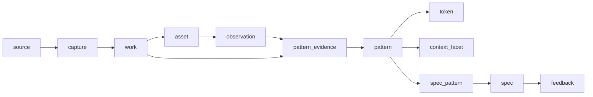

# UI 灵感引擎设计

> 设计稿 v0.1 ｜ 2026-11-10 ｜ **已于 2026-11-10 归档**，被 [灵感引擎设计](../../design/灵感引擎设计.md) v1.0 取代（v0.1 只覆盖 UI 单一领域）｜ 首个数据源：[Designeer 接入规范](../../design/Designeer数据源接入.md) ｜ DDL：[inspiration-schema.v1.sql](inspiration-schema.v1.sql)
>
> 本文是**设计**，不是已交付功能。文中数字分两类：标「实测」的来自 2026-11-10 对目标站点的真实请求；标「估算」的是容量与成本推算。

## 0. 一页结论

AI 生成 UI 的瓶颈不在画得出像素，而在**做不出可辩护的设计决策**：间距为什么是 8 而不是 12、空状态要不要放插画、错误提示贴在字段旁还是页首。模型缺的不是审美词，是可检索的**判断 + 证据 + 边界**。

所以灵感引擎的数据单位不是"图"，而是**设计决策**：

```text
source ── capture ── work ── observation ── pattern ── spec ── critique
 谁提供     抓到了什么   哪个作品    量到了什么     可复用的判断   本项目的规格   哪里偏离了规格
                                  ↑ 证据                     ↑ 结论
```

- **三层数据**：目录层（谁值得看）、视觉层（画面量到了什么）、决策层（为什么、何时不这样做）。
- **一条硬规则**：没有反例的 `pattern` 不得发布。只有支持证据的"主张"只是刻板印象，会把 AI 推向更平庸的模板。
- **服务形态**：本地 SQLite + Rust CLI（`ie`），无 HTTP 服务；以 DeepSeek Harness 的 skill 包装给 Agent 调用，同一内核可被任何 harness 或桌面端复用。
- **首个数据源的真实结论**（实测）：Designeer 是**手工策展的目录站**，不是截图语料库。它能提供 678 条 listing、163 条 finds、827 张 1200×675 海报的地址、一套五分类 taxonomy；**详情页、`.md`、`/api/catalog` 均被 Cloudflare 人机校验拦截**，逐条标题与描述只能从 `llms.txt` 拿到 50 条（670 条中的 7.5%）。因此它只能撑起"目录层"，视觉层与决策层必须靠自采海报抽取 + 用户样本补齐。这个边界决定了 M0/M1 的排期，必须先写在设计里，而不是等实现时才发现。

## 1. 问题定义

现有 AI 设计工具（v0/v1、Stitch、Lovable 一类）的共同失败模式：

| 失败模式 | 表现 | 根因 |
| --- | --- | --- |
| 默认风格坍缩 | 任何需求都产出"紫蓝渐变 + 玻璃卡片 + 大方圆角" | 训练分布的中心，而不是任务的最优 |
| 决策不可解释 | 问"为什么这样排版"答不出，改一处坏一片 | 只有像素级先验，没有约束记忆 |
| 参考与实现脱节 | 给了一堆截图，生成时全忘 | 参考资料是图片，不是可执行规格 |
| 无法批判 | 只会生成，不会说"你这里错了" | 没有"项目规格"这一可对照的对象 |
| 数据一次性 | 每次对话都从零找灵感 | 没有本地、可积累、可引用的库 |

灵感引擎针对的是后三条：**把参考变成规格，把规格变成可对照的标准，把使用反馈沉回库里**。

## 2. 设计原则

1. **决策优先于图片。** 图片是证据，不是知识。一个 `observation` 只有升格成 `pattern` 才对生成有用。
2. **没有反例不发布。** 每条 pattern 至少 3 条支持证据 + 1 条反例或明确边界，否则停留在 `candidate`。
3. **来源可追溯、许可可分。** 任何输出都能回到 `capture`（何时、从哪、什么哈希），并带上源站的署名要求。
4. **原文与衍生分离。** 源站描述进 `subtitle_quoted`（引用必署名），引擎自己的话进 `summary_derived`。不能把策展文案洗成自有内容。
5. **单一文件、零服务。** 一个 `inspiration.db` + 一个 `blobs/` 目录；命令行走 stdin/stdout，不监听端口。
6. **审美偏差要显式记录。** 每个源都有自己的口味分布；规格输出必须标注"偏向哪个源"，否则引擎会把窄分布当成全世界。

## 3. 领域模型

### 3.1 五层对象

| 层 | 对象 | 回答的问题 | 典型字段 |
| --- | --- | --- | --- |
| 来源 | `source` / `capture` | 这条数据谁给的、什么时候抓的、能不能用 | 许可、限速、内容哈希、抓取批次 |
| 目录 | `work` / `work_tag` / `asset` | 这是哪个作品、属于哪类、有什么图 | 集合、slug、作者、原始链接、海报 |
| 观察 | `observation` | 画面里量到了什么 | 栅格、字阶、色板、圆角、动效时长、置信度 |
| 结论 | `pattern` / `token` / `context_facet` | 什么条件下该怎么做、不该怎么做 | 主张、理由、约束、反例、证据数 |
| 交付 | `spec` / `spec_pattern` / `feedback` | 这个项目该用哪套、用完之后效果如何 | 简报、DESIGN.md、采用/否决信号 |

### 3.2 证据图



关键约束：

- `pattern_evidence.role ∈ {support, counter, variant}`。**variant 是刻意保留的分歧**——同一个位置两种做法都成立时，不要合并成一个中庸结论，而是记成 variant，让规格按项目条件选边。
- `observation` 带 `extractor_version`，换模型后可重跑并对比，不一致的条目进复核队列，不静默覆盖。
- `work.status` 区分 `active / gone / blocked / draft / retired`：链接腐烂是常态，`blocked` 专门标记"源站不放行"。

### 3.3 为什么 `pattern` 是核心

一条 pattern 是可执行的一句话 + 边界：

```json
{
  "key": "form.inline-error",
  "statement": "校验错误贴在对应字段下方，输入框描边同时变红",
  "rationale": "视线不需要在两个位置间跳；错误与字段的归属关系无需解释",
  "constraints": {"page": ["auth", "settings"], "density": ["comfortable"], "a11y": ["not color-only"]},
  "antipattern": "错误汇总在页首时，字段多于 6 个用户无法定位；移动端需滚动回看",
  "evidence": {"support": 7, "counter": 2, "sources": ["designeer", "capture-inbox"]}
}
```

它同时满足三个消费方：Agent 可以照做（statement）、可以解释（rationale）、可以判断例外（constraints/antipattern）。

## 4. 本地数据库

单文件 SQLite（WAL + FTS5），DDL 见 [inspiration-schema.v1.sql](inspiration-schema.v1.sql)，已用 `sqlite3 3.54` 实测建表、触发器、视图与外键检查通过。

### 4.1 表分组

| 组 | 表 | 说明 |
| --- | --- | --- |
| 元信息 | `schema_meta` | 迁移版本，迁移脚本按 version 递增 |
| 来源 | `source`, `fetch_run`, `capture` | 抓取可重放：同一 URL 同哈希不重复入库 |
| 目录 | `work`, `work_tag`, `asset` | `(source_id, collection, slug)` 唯一；`canonical_url` 唯一 |
| 观察 | `observation` | `(asset_id, extractor, version, schema_version)` 唯一，保证幂等 |
| 结论 | `pattern`, `pattern_evidence`, `token`, `context_facet` | 结论与证据多对多，支持反例 |
| 交付 | `spec`, `spec_pattern`, `feedback` | 规格可派生（`parent_id`），反馈可回灌排序 |
| 检索 | `search_doc` + `search_fts` | 单一索引覆盖 work/pattern/spec |

### 4.2 检索的两个坑（已实测）

1. **主键不能只用 slug。** Designeer 的 sitemap 里 `dev-chauhan`、`diar-muradi` 在两个集合各出现一次（实测）。唯一键必须是 `(source, collection, slug)`。
2. **unicode61 不切中文。** 直接 `MATCH '标签'` 只有整词命中，中文短语基本查不到。方案：`search_doc.terms` 由引擎用 jieba-rs 预分词（空格分隔），查询词同样先分词再拼 MATCH；`body` 保留原文服务英文与短语。实测该组合下 `MATCH '标签 AND 表单'` 可命中中文 pattern。

### 4.3 向量

不引入外部向量库。`embedding` 表存 float32 blob + 预计算范数，查询时暴力余弦：

| 规模 | 维度 | 内存 | 单次全量打分（估算，单核） |
| --- | --- | --- | --- |
| 1 万条 | 768 | 30 MB | ~15 ms |
| 10 万条 | 768 | 300 MB | ~150 ms |

只对 `work.summary_derived` 与 `pattern.statement` 建向量，不建在原始 OCR 文本上。10 万条以内无需 ANN，省掉一个数据库进程。

### 4.4 素材存储

海报与截图存 `blobs/<sha 前两位>/<sha>`，SQLite 只存路径与哈希。按 Designeer 实测单张 16–52 KB 推算，827 张合计约 **25–40 MB（估算）**；全部本地缓存是合理的，但**不提交仓库**（与仓库数据保护约定一致）。

## 5. 采集与加工

### 5.1 三级接入能力

不是所有源都能自动抓，引擎按能力分三级，`source.policy_json` 里声明：

| 级别 | 手段 | 适用 | 代价 |
| --- | --- | --- | --- |
| A 自动 | HTTP 抓公开端点（sitemap/llms.txt/API/CDN） | 有机器接口的源 | 低，可定时 |
| B 浏览器辅助 | 用户把页面另存为 HTML/Markdown 丢进 `inbox/`，引擎解析 | 有人机校验、需登录的源 | 人工一次，可批 |
| C 手工 | `ie add --url ... --tags ...` | 零散收藏、设计评审记录 | 最高，最准 |

Designeer 属于 **A + B 混合**：目录骨架与海报走 A，逐条详情走 B。

### 5.2 流水线

```text
fetch(polite) → normalize → dedupe(sha256) → extract → review → publish
                                   │                       │
                                   └ vision(截图) / css(活站点) / manual ┘
```

- **抓取礼貌**：遵守 robots.txt 与 ai.txt；单域 1 req/s；带条件请求（ETag/Last-Modified）；UA 标识自己并留联系方式；连续失败指数退避并降级到 B。
- **抽取器**：`vision-llm` 对海报/截图输出固定 JSON（布局骨架、栅格数、字阶、色板、圆角、阴影、动效线索、密度、明暗），`css-probe` 对可访问的活站点抓 computed style，`manual` 走人工。
- **成本控制**：只对"入选"素材跑 vision（先用目录层筛选）；批量 20 张一次调用；结果按 `(asset, extractor, version)` 缓存，重跑不重复付费。
- **审核**：`observation.confidence < 0.6` 或与已有观察冲突时进复核队列；`pattern` 从 `candidate → published` 需满足"3 支持 + 1 反例/边界"。

### 5.3 置信度

```text
conf = Σw / (Σw + 2)                      # w 为证据权重（来源质量 × 抽取置信 × 时间衰减）
sources = distinct(work.source_id)         # 单一来源时标 single-source，conf 乘 0.7
```

时间衰减用半衰期 18 个月：设计口味会变，2022 年的"新拟态"不该和 2026 年的证据等权。

## 6. 检索与装配

### 6.1 混合打分

```text
score = 0.45·cos + 0.30·bm25_norm + 0.15·facet_match + 0.10·prior
prior = 0.6·freshness + 0.4·usage            # usage 来自 feedback，避免"热门即正确"
```

- `facet_match`：平台、页面类型、密度、明暗、动效强度、年代。
- 输出前做 MMR（λ=0.7）去重，避免 10 条结果全是同一作者的同一风格。
- 查询解析：自然语言 → facets + 关键词；解析失败就退化为纯 BM25，不阻塞。

### 6.2 三种检索原语

| 原语 | 输入 | 输出 | 用在 |
| --- | --- | --- | --- |
| `evidence` | 查询 + facets | 作品卡片（图、理由、来源、许可） | 找参考 |
| `pattern` | 场景 + 约束 | 可复用判断（含反例） | 做决定 |
| `spec` | 产品简报 | DESIGN.md（tokens + 组件规则 + 动效 + 反模式） | 开工前 |

### 6.3 规格装配的冲突消解

同一个 `slot`（如 hero）命中多条 pattern 时：

1. 按 `conf × context_match` 排序；
2. 若前两条 `role='variant'` 互相排斥，**不取平均**，按简报里的条件选边（如 "B2B 密集表格" → 选信息密度高的那条），并在输出里写明"另一派做法是什么、为什么没选"；
3. 无 pattern 覆盖的 slot 留空并标注 `gap`，不编造。

`gap` 很重要：它让 Agent 知道哪里需要人来定，而不是自信地瞎填。

### 6.4 批判

`ie critique --screenshot x.png --spec DESIGN.md`：vision 抽 observation → 与 spec 的 token/pattern 比对 → 输出偏差清单，按"严重度 × 证据"排序，每条附一条 pattern 依据。这是把库变成"可对照标准"的关键一步，也是与"又一个图库"的分水岭。

## 7. 服务接口

CLI 优先（无服务、可脚本化、可被任何 Agent 调用）：

```sh
ie search "b2b onboarding 空状态" --facet platform=web --facet density=comfortable --k 8 --json
ie pattern "登录表单的错误提示位置" --context '{"page":"auth","platform":"web"}' --json
ie spec --profile profile.json --out DESIGN.md --json
ie critique --screenshot shot.png --spec DESIGN.md --json
ie record --target pattern:12 --signal rejected --note "项目要求极简"
ie sync designeer --mode auto         # 目录层
ie sync designeer --from-inbox        # 浏览器辅助的详情层
```

统一 JSON 信封：

```json
{
  "query": "...",
  "items": [{"kind": "work", "id": 12, "title": "...", "why": "...",
             "citation": {"source": "designeer", "url": "https://designeer.xyz/inspiration/mobbin",
                          "licence": "rights with creator", "retrieved_at": "2026-11-10"}}],
  "gaps": ["该场景缺少反例证据"],
  "bias": {"sources": ["designeer"], "note": "偏向英文 web 设计目录，移动端样本稀疏"}
}
```

**引用规则写进契约，不只写进提示词**：每条输出必带 `citation`；没有 citation 的条目不允许出现在 `spec` 正文里。

## 8. DSH 接入

| 方案 | 形态 | 优点 | 代价 |
| --- | --- | --- | --- |
| A（推荐 v1） | Rust CLI + DSH skill | 零服务、离线可用、任何 harness 可复用、与"不使用本地 HTTP 服务"的约定一致 | Agent 要通过 bash 调命令，交互反馈不如原生工具卡片 |
| B（v2） | DSH plugin（TS）包 CLI | 可提供结构化工具与 GUI 卡片 | 需要维护插件与二进制版本匹配 |

v1 的 skill 只需教 Agent 三件事：

```markdown
---
name: ui-inspiration
description: 做 UI 前先查本地灵感库：检索证据、取设计规格、批判现有界面。
---
1. 动手前：`ie spec --profile ...` 拿 DESIGN.md；无 profile 时先问平台/受众/密度。
2. 找参考：`ie search ...`，只引用返回的 citation，不改写来源文案。
3. 交付前：`ie critique` 自查，修掉严重度 high 的偏差。
4. 用完记录：`ie record`，让排序学习你的口味。
```

若其他 harness（Claude Code / Cursor）也要用，再加 stdio MCP（**不是 HTTP 服务**），工具名与 CLI 一一对应。

## 9. 与星晴的关系

可复用的是**模式**，不是数据：证据-审核-幂等 Run 的结构与 `aicomic-memory` 同构，迁移与审核思路可直接借鉴；但灵感库是独立数据库与独立 workspace：正式形态用自己的应用数据目录，本仓库里只放设计与开发期验证库（`data/inspiration/`，已被 gitignore），不与漫剧项目的 `projects/` 混放。若将来星晴要做界面风格统一，以只读方式调用 `ie` 即可。

## 10. 评测

| 维度 | 方法 | 门槛 |
| --- | --- | --- |
| 检索 | 30 条人工查询的 nDCG@10 | ≥ 0.6 |
| 规格可用性 | 双盲 A/B：有 spec vs 无 spec 生成同简报，5 维评分 | spec 组胜率 ≥ 70% |
| 批判准确率 | 20 张已知缺陷截图 | 召回 ≥ 0.7，误报 ≤ 0.2 |
| 反同质化 | 10 份不同简报产出的 spec 两两余弦 | 平均 < 0.85 |
| 引用完整性 | 抽样 100 条输出 | citation 覆盖率 100% |

反同质化指标容易被忽略，但它是这类系统的真实风险：如果所有简报都收敛到同一套 tokens，引擎只是把"默认紫蓝渐变"换成了"默认 shadcn 灰"。

## 11. 里程碑

| 阶段 | 内容 | 验收 |
| --- | --- | --- |
| M0 骨架 | schema + Designeer 目录导入 + FTS + `ie search` | 841 条 work、827 张海报入库；中文查询可命中 |
| M1 规格 | 200 条 pattern 种子（人工 + LLM 标注）+ `ie spec` | 3 个真实简报产出可执行 DESIGN.md |
| M2 闭环 | vision 抽取 + `ie critique` + feedback 回灌 | 批判召回达标；排序随反馈变化 |
| M3 扩展 | 第二数据源（用户样本/公开组件库）+ DSH plugin | 双源证据的 pattern 占比 ≥ 30% |

> 进度说明（2026-11-10）：M0 的**数据映射**已用一次性脚本实跑验证（841 条 work、50 条富化、827 条海报 URL、12 张海报抽样入库，见接入文档 §6），但 Rust CLI、全量海报、pattern 种子都还没写。验证脚本不是交付物，仓库里只有设计与 DDL。

## 12. 风险

| 风险 | 影响 | 对策 |
| --- | --- | --- |
| 源站人机校验 | 详情层抓不到（当前实测 100% 拦截） | 三级降级；B 级 inbox 导入；持续观察 `llms-full.txt` 恢复 |
| 许可与再分发 | 作品图版权在创作者 | 本地缓存可，对外输出只给引用与链接；不打包分发图片 |
| 数据漂移 | 链接腐烂、条目下架 | `last_seen_at` + `status='gone'`；30 天未复验进 stale 视图 |
| 审美同质化 | 规格收敛到单一风格 | 多源要求、variant 保留、偏差登记、反同质化评测 |
| 单源偏见 | 目录站偏好英文 web | 输出标注 `bias`；用户项目截图作为校正锚点 |
| 成本 | vision 抽取按张计费 | 先目录筛选再抽取；批量；版本化缓存 |

## 13. 待决问题

1. embedding 用本地模型（bge-m3 + candle，离线、免费、首启慢）还是 API（省事、按量付费）？
2. pattern 种子由人标还是 LLM 批量标后人工抽检？前者准、慢；后者快、需要抽检比例。
3. 首个真实用户是"星晴的界面"还是独立产品？这决定 M1 的简报样本。
4. 是否需要把 `work` 的原始海报一并入 git LFS 做可复现演示？（默认否，涉及版权与体积。）

## 附录 A · 首个数据源

Designeer 的端点矩阵、字段映射、归一化规则与导入流程见 [Designeer 数据源接入](../../design/Designeer数据源接入.md)。

## 附录 B · 命令与 schema 对应

| 命令 | 主要表 |
| --- | --- |
| `ie sync` | `source`, `fetch_run`, `capture`, `work`, `asset` |
| `ie search` | `search_fts`, `work`, `work_tag`, `embedding` |
| `ie pattern` | `pattern`, `pattern_evidence`, `context_facet` |
| `ie spec` | `spec`, `spec_pattern`, `token` |
| `ie critique` | `observation`, `spec`, `token` |
| `ie record` | `feedback` |
