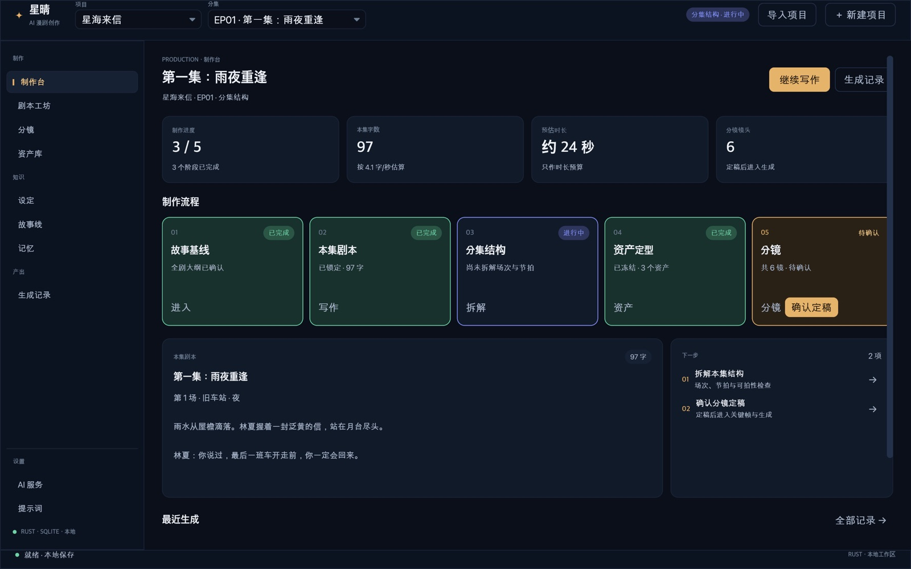
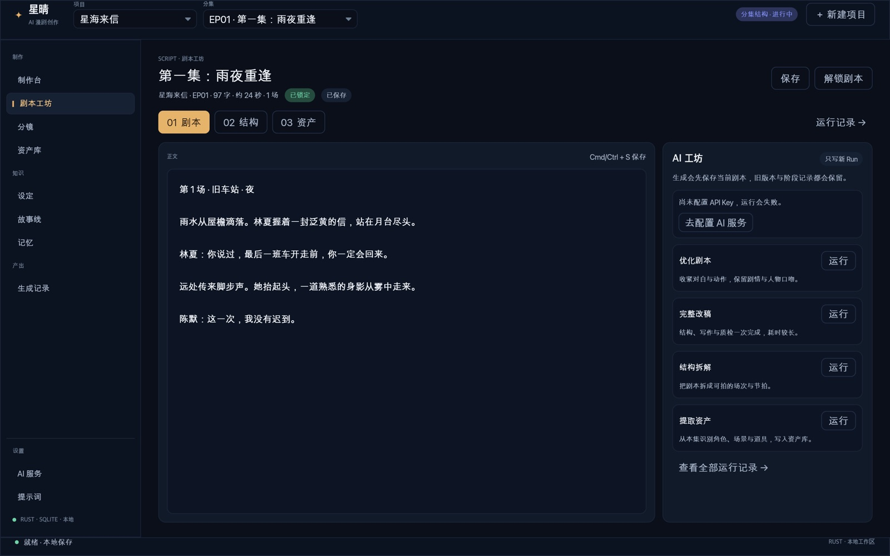
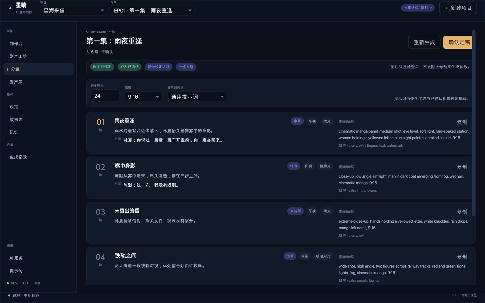
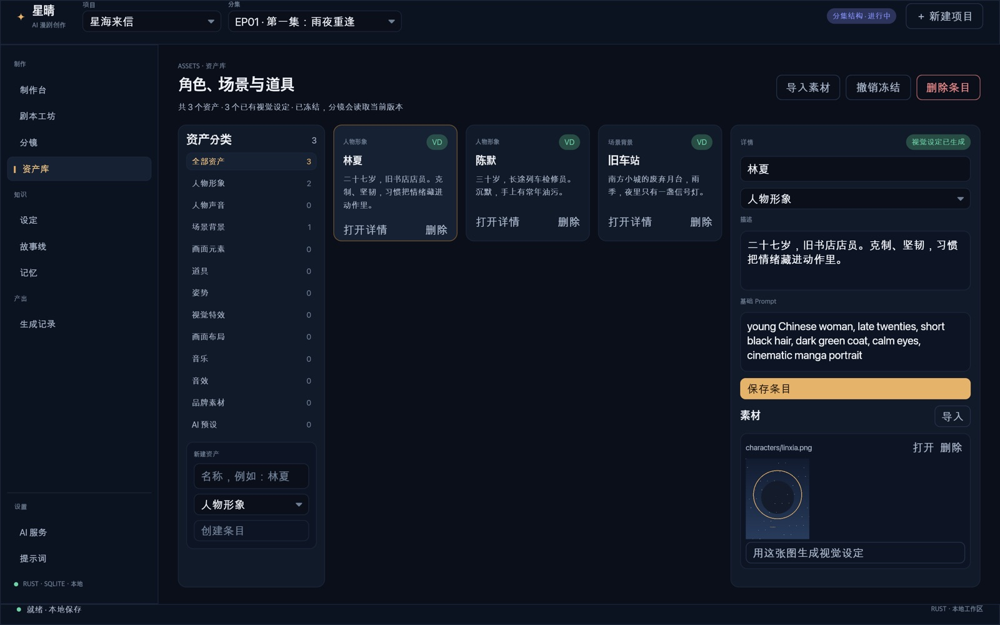
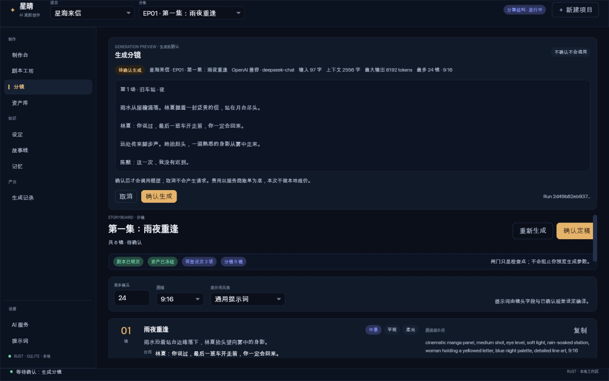

# 星晴工作流与界面重设计

> 设计稿 v1 ｜ 2026-11-09 ｜ 依据：[漫剧开源工作流研究](漫剧开源工作流研究.md)
>
> 本文档描述**已实现的 v1 界面**与**后续阶段的规划**，两者在文中明确区分。研究文档中的外部项目能力与成本均来自公开资料，不等于星晴已具备的能力。

## 界面预览

演示数据，原生 Iced 窗口截图（1440×900 逻辑尺寸，2× 缩放）：

| 制作台 | 剧本工坊 |
| --- | --- |
|  |  |

| 分镜 | 资产库 |
| --- | --- |
|  |  |

## 0. 一页结论

星晴原来是一个"工具集合"：剧本、事件、资产、上下文、运行、记忆、设置各自并列。它什么都有入口，却无法回答创作者最关心的三个问题——**这一集做到哪一步了、下一步该做什么、现在能不能花钱生成**。

重设计把它改为一条以"集"为单位的制作线：

```text
故事基线 → 本集剧本 → 分集结构 → 资产定型 → 分镜 → 关键帧/成片（规划）
             │           │          │         │
             └─ 锁定 ────┴─ 确认 ───┴─ 冻结 ──┴─ 定稿
```

五个已实现阶段各自有：明确输入、明确产物、可判定的状态、必须由人确认的闸门。镜头表成为剧本与画面之间的中枢，资产在冻结之前不进入批量生成。界面只做三件事：**展示当前阶段、暴露下一步、守住闸门**。

## 1. 现状诊断

| 问题 | 旧界面的表现 | 后果 |
| --- | --- | --- |
| 没有制作主线 | 顶部八个并列页签，剧本页内又有 01/02/03 三个步骤 | 新用户不知道从哪开始，老用户靠记忆找入口 |
| 阶段不可见 | 是否生成过大纲、资产、分镜，只能进运行记录逐条翻 | 无法判断"这一集能不能开做" |
| 闸门缺失 | 提取资产与生成动作之间没有确认点；剧本可边生成边改 | 资产未定时就消耗生成额度，返工率高 |
| 镜头不是一等公民 | 分镜工作流已存在，但只躺在运行产物 JSON 里 | 无法以镜头为单位检查、复制提示词、确认定稿 |
| 视觉层级失败 | 所有按钮同色同权重；编辑器正文与背景对比不足 | 主操作不突出，长文写作疲劳 |
| 资产与剧本脱节 | 资产库是独立页面，剧本页看不到本集需要哪些角色 | 漏资产、重复建资产 |

## 2. 设计原则

1. **一集一条产线。** 所有页面都围绕"当前项目 + 当前分集"组织；项目级设定（故事基线、资产）明确标注作用域。
2. **镜头是中枢。** 剧本提供动作与台词，资产提供一致性，分镜把两者编译成可执行的镜头行。没有分镜，不进入画面生成。
3. **闸门前置。** 研究里最贵的一课是"成片后返工比生成前确认贵一个数量级"。只设五个闸门，每个都有明确判据，不做无意义的确认弹窗。
4. **写作优先。** 编辑器占据最大的连续区域，AI 动作收在右侧；不用 AI 按钮包围正文。
5. **生成即证据。** 每次生成保留运行、阶段与产物；界面只读展示，重做通过新 Run 完成，不覆盖旧结果。
6. **少即是稳。** 不提供"一键生成整集"入口；不在资产未冻结时开放批量。

## 3. 制作模型

### 3.1 阶段、输入与产物

| 阶段 | 作用域 | 输入 | 产物 | 闸门 | 当前状态 |
| --- | --- | --- | --- | --- | --- |
| S0 故事基线 | 项目 | 故事概述、预计集数 | `series_bible`、`project_outline` | 大纲确认 | 已实现 |
| S1 本集剧本 | 分集 | 原文/大纲、上一版剧本 | 可拍剧本、优化稿 | 剧本锁定 | 已实现 |
| S2 分集结构 | 分集 | 锁定剧本 | `outline` / `beat_sheet` | 结构确认 | 已实现（产物级） |
| S3 资产定型 | 项目 | 剧本中的角色/场景/道具 | 资产条目、Visual DNA、参考素材 | 资产冻结 | 已实现 |
| S4 分镜 | 分集 | 锁定剧本 + 冻结资产 + 全局风格 | `shots`（景别/角度/光线/动作/台词/提示词） | 分镜定稿 | 已实现（产物级） |
| S5 关键帧 | 分集 | 分镜行 + 资产参考 | 首帧/尾帧 | 首帧抽检 | 规划 |
| S6 生成 | 分集 | 关键帧、运镜、音色 | 片段、配音、字幕 | 片段抽检 | 规划 |
| S7 合成与审片 | 分集 | 片段、音频、字幕 | 时间线、成片 | 成片审 | 规划 |

"产物级"指工作流已经产出结构化 JSON 并持久化到运行产物，但尚未写入 `shots` 表。S5 之后需要任务表、生成 provider 与媒体管线，属于后续里程碑。

### 3.2 闸门

闸门不是装饰，它改变后续动作是否可用。

| 闸门 | 判据 | 存储 | 打开后 | 失效条件 |
| --- | --- | --- | --- | --- |
| 大纲确认 | `project_outline` 非空且用户确认 | 项目上下文 `production_state.v1` | 分集剧本可按大纲推进 | 重新生成/保存大纲 |
| 剧本锁定 | 本集剧本非空且已保存 | `episodes.script_locked` | 可进入结构拆解与分镜 | 编辑并保存正文 |
| 结构确认 | 存在 `outline` 或 `beat_sheet` | 项目上下文 `production_state.v1` | 可用于资产提取与分镜 | 重新拆解 |
| 资产冻结 | 项目内至少一个资产条目且用户确认 | 项目上下文 `production_state.v1` | 分镜生成读取一致的视觉设定 | 新增/删除/修改资产 |
| 分镜定稿 | `shots` 非空且用户确认 | 项目上下文 `production_state.v1` | 进入关键帧与生成 | 重新生成分镜 |

`production_state.v1` 是桌面端新增的项目上下文文件，不改变 SQLite 表结构，旧项目首次打开时自动视为未确认：

```json
{
  "schema_version": "production.v1",
  "outline_approved": false,
  "assets_frozen": false,
  "episodes": {
    "1": {
      "structure_approved": false,
      "storyboard_approved": false
    }
  }
}
```

### 3.3 状态推导

阶段状态不靠人工勾选，而由真实数据推导，再用闸门区分"有产物"与"已确认"：

```text
Empty    没有输入，也没有产物
Active   有部分输入或产物，尚未达到闸门判据
Review   产物已经具备，等待人工确认
Done     闸门已确认
```

例如分镜阶段：`shots` 为空且剧本未锁定 → `Empty`；`shots` 为空但剧本已锁定 → `Active`；`shots` 非空但未确认 → `Review`；已确认 → `Done`。

### 3.4 分镜字段（已实现版本）

当前 `workflow_storyboard` 产出以下字段，界面按镜头行展示：

| 字段 | 说明 |
| --- | --- |
| `action_text` | 原子化动作，一句 |
| `title` / `dialogue` | 镜头标题与台词，可选 |
| `shot_size` | ELS / LS / MS / CU / ECU / INSERT，受控词表 |
| `camera_angle` | EYE / LOW / HIGH / DUTCH |
| `lighting_style` | SOFT / HARD / CHIAROSCURO / RIM / VOLUMETRIC |
| `prompt` / `negative_prompt` | 由分镜字段与锁定视觉设定编译，不由 LLM 自由重写 |

下一版在保持兼容的前提下扩展：`duration_ms`、`camera_move`、`blocking`、`continuity_in/out`、`refs`、`first_frame/last_frame`。字段合并清单见研究文档附录 A。

### 3.5 运行、恢复与版本

- 一次生成 = 一个 Run；Run 下有 `chat.plan`、`chat.status`、领域阶段与 `desktop.materialization`。
- 生成前先保存剧本；运行中不可编辑同一集的资产/删除项目；结果写入失败时保留待提交产物，可重试而不是重跑。
- 重做生成新 Run，旧 Run 与旧产物保留。界面不提供"覆盖原结果"。
- 审核暂停（`paused`）继续沿用现有 `waiting_for` 机制，不新增第二套状态。

## 4. 信息架构

### 4.1 应用外壳

```text
┌──────────────────────────────────────────────────────────────────────────┐
│ ✦ 星晴  [项目 ▾] [EP01 · 雨夜重逢 ▾]        [本集 · 剧本阶段]  [＋ 新建] │ 64
├────────────┬─────────────────────────────────────────────────────────────┤
│ 制作       │                                                             │
│  制作台    │  页面标题 / 说明 / 主次操作                                  │
│  剧本工坊  │                                                             │
│  分镜      │  页面主体                                                   │
│  资产库    │                                                             │
│ 知识       │                                                             │
│  设定      │                                                             │
│  故事线    │                                                             │
│  记忆      │                                                             │
│ 产出       │                                                             │
│  生成记录  │                                                             │
│ 设置       │                                                             │
│  AI 服务   │                                                             │
│  提示词    │                                                             │
├────────────┴─────────────────────────────────────────────────────────────┤
│ 就绪 · 本地保存                                       Rust · 本地工作区  │ 32
└──────────────────────────────────────────────────────────────────────────┘
```

- **顶栏**只放全局范围：项目、分集、当前阶段、新建入口。不放页面级操作。
- **左栏**按"制作 / 知识 / 产出 / 设置"分组，图标位置用短标记（▍、◇），不使用彩色小方块堆叠。
- **主区**一屏只解决一个任务；页面标题统一为"眉题 + 标题 + 说明 + 右侧操作"。
- **底栏**显示保存与运行状态，始终可见。

### 4.2 页面职责

| 页面 | 回答的问题 | 主要操作 |
| --- | --- | --- |
| 制作台 | 这一集做到哪了？下一步？ | 继续写作、确认闸门、跳转阶段 |
| 剧本工坊 | 这一集的文字是什么状态？ | 写作、优化、锁定、拆解、提资产 |
| 分镜 | 每个镜头拍什么？提示词是什么？ | 生成分镜、复制提示词、确认定稿 |
| 资产库 | 角色/场景/道具是否齐全、是否冻结？ | 建资产、导素材、生成视觉设定、冻结 |
| 设定 | 世界观与大纲是什么？ | 编辑设定、生成/优化大纲、确认大纲 |
| 故事线 | 事件与场景如何对应？ | 事件维护、场景关联、矩阵查看 |
| 记忆 | 哪些事实已被确认？哪些变更待审？ | 检索、审核变更、裁决冲突 |
| 生成记录 | 每次生成做了什么、产物在哪？ | 查看 Run/阶段、恢复暂停任务 |
| AI 服务 | 模型、参数、Embedding 是否可用？ | 配置、测试、保存 |
| 提示词 | 工作流提示词是什么？ | 编辑、恢复内置、删除自定义 |

旧界面页签到新界面的映射：

| 旧页面 | 新位置 |
| --- | --- |
| 剧本 | 剧本工坊 + 制作台 |
| 事件 | 故事线 |
| 资产 | 资产库 |
| 项目上下文 | 设定 |
| 运行记录 | 生成记录 |
| 记忆 | 记忆 |
| AI 设置 | AI 服务 |
| Prompt 模板 | 提示词 |

## 5. 页面规格

### 5.1 制作台

```text
PRODUCTION · 制作台                                    [继续写作] [记录]
雨夜重逢
星海来信 · 第 1 集 · 剧本待锁定                              EP 01

┌ 进度 2/5 ┐ ┌ 剧本 111 字 ┐ ┌ 预估 27 秒 ┐ ┌ 分镜 0 镜 ┐
└──────────┘ └─────────────┘ └────────────┘ └──────────┘

制作流程
┌ 01 故事基线 ┐ ┌ 02 本集剧本 ┐ ┌ 03 分集结构 ┐ ┌ 04 资产定型 ┐ ┌ 05 分镜 ┐
│ 待确认      │ │ 进行中      │ │ 未开始      │ │ 未开始      │ │ 未开始   │
│ …           │ │ …           │ │ …           │ │ …           │ │ …        │
│ [进入]      │ │ [写剧本]    │ │ [拆结构]    │ │ [去资产]    │ │ [去分镜] │
└─────────────┘ └─────────────┘ └─────────────┘ └─────────────┘ └──────────┘

┌ 本集剧本 ─────────────────────────┐ ┌ 下一步 ──────────────────────┐
│ 第一集：雨夜重逢                  │ │ 01 锁定剧本        [处理]    │
│ 雨水从屋檐滴落……                  │ │ 02 拆解结构        [处理]    │
│ 111 字 · 约 27 秒                 │ │ 03 提取资产        [处理]    │
└───────────────────────────────────┘ └──────────────────────────────┘

最近生成
· workflow_script  完成  · 2 分钟前
```

- 顶部不使用大幅插画；用"眉题 + 集标题 + 集号"建立编辑感。
- 五张阶段卡是制作台的骨架；边框颜色即状态，不依赖小圆点。
- "下一步"最多三条，按阻塞顺序排列：锁定剧本 → 拆结构 → 提资产 → 分镜。
- 剧本摘要截断到约 260 字，完整编辑回剧本工坊。
- 空项目进入引导页，而不是空白工作台。

### 5.2 剧本工坊

```text
SCRIPT · 剧本工坊                           [保存] [锁定剧本]
第一集：雨夜重逢
星海来信 · 第 1 集 · 已保存        111 字 · 约 27 秒 · 1 场

[剧本] [结构] [资产]

┌ 正文 ───────────────────────────────┐ ┌ AI 工坊 ─────────────┐
│                                     │ │ 优化剧本             │
│  第一集：雨夜重逢                   │ │ 收紧对白与动作       │
│                                     │ │            [运行]    │
│  雨水从屋檐滴落。林夏握着一封泛黄   │ │ 完整改稿             │
│  的信，站在月台尽头。               │ │ 结构 + 写作 + 质检   │
│                                     │ │            [运行]    │
│  林夏：你说过……                     │ │ 结构拆解             │
│                                     │ │            [运行]    │
│                                     │ │ 提取资产             │
│                                     │ │            [运行]    │
│                                     │ └──────────────────────┘
└─────────────────────────────────────┘
```

- 标题可直接编辑；保存状态紧跟标题，不用弹窗。
- 字数是去掉空白后的可发声字符数；预估时长按研究中的 **4.1 字/秒** 估算，仅作预算提示。
- 正文编辑器使用比面板更深的底色、15px 字号与 1.75 行高；编辑区占满剩余高度。
- AI 工坊每个动作给出"做什么"，而不是只有动词按钮。运行中统一禁用并显示取消。
- 步骤切换保留：01 剧本、02 结构、03 资产；02/03 使用画布卡片 + 详情，不再把 JSON 直接丢进编辑器。
- 有暂停审核时，在标题下方显示确认条；有未写入产物时显示重试条，不和普通状态混在一起。

### 5.3 分镜

```text
STORYBOARD · 分镜                              [生成分镜] [确认定稿]
镜头表
星海来信 · 第 1 集 · 共 0 镜

[剧本已锁定 ✓] [视觉设定 3 项] [资产已冻结 ✓]

生成参数   最多 [24] 镜   画幅 [9:16 ▾]   提示词 [通用 ▾]   [开始生成]

┌─────────────────────────────────────────────────────────────────────┐
│ 分镜表还空着                                                        │
│ 生成前请确认剧本已锁定、资产已冻结。                                │
│ [去锁定剧本] [去资产库]                                             │
└─────────────────────────────────────────────────────────────────────┘
```

有镜头时每行一张卡：

```text
01  中景 · 平视 · 柔光        [复制提示词]
    雨水沿着站台边缘落下，林夏抬头望向雾中的身影。
    台词：林夏：你说过，最后一班车开走前，你一定会回来。
    提示词：cinematic manga panel, medium shot, eye level, soft light, ...
```

- 镜头行是只读产物；修改分镜通过重新生成新 Run 完成，避免在 UI 里手改结构化 JSON 后失去可追溯性。
- 景别/角度/光线使用受控词表的中文标签，同时保留英文代码，方便与提示词核对。
- "确认定稿"只在 `shots` 非空时出现；确认后如果重新生成，自动回到待确认。
- 提示词复制到剪贴板，不自动调用任何付费接口。

### 5.4 资产库

```text
ASSETS · 资产库                              [导入素材] [冻结资产]
角色、场景与道具
共 6 个资产 · 3 个已有视觉设定

┌ 分类 ──────┐  ┌ 资产网格 ─────────────────────┐  ┌ 详情 ─────────┐
│ 全部 6     │  │ ┌ 林夏 ─────┐ ┌ 陈默 ─────┐  │  │ 名称 [林夏]   │
│ 人物形象 3 │  │ │ 人物形象  │ │ 人物形象  │  │  │ 分类 [..]     │
│ 场景背景 2 │  │ │ VD ✓      │ │ VD —      │  │  │ 描述 …        │
│ 道具 1     │  │ └───────────┘ └───────────┘  │  │ 基础 Prompt … │
│ + 新建     │  │                               │  │ [保存]        │
└────────────┘  └───────────────────────────────┘  │ 素材缩略图     │
                                                    └───────────────┘
```

- 分类是内容导航，不用下拉框藏在右上角。
- 资产卡整张可点击选择，不依赖卡内的小按钮；卡片显示"是否有视觉设定"，这是分镜一致性的前置条件，比文件名重要。
- 详情面板保留名称、分类、描述、基础 Prompt、素材导入/删除。
- 冻结按钮是项目级闸门；冻结后新增/修改/删除资产会自动解除冻结，并在制作台提示重新确认。
- 未选资产时，详情面板显示导入与建资产的简短说明，不留空白。

### 5.5 设定、故事线、记忆、记录、设置

- **设定**：保留"故事设定 / 项目大纲 / 资产视觉设定"三类文档；表单化编辑；生成大纲与优化大纲放在右侧"大纲工具"卡；大纲存在时提供"确认大纲"。
- **故事线**：事件列表 + 矩阵 + 场景关联保持不变，只统一标题、面板与按钮层级。
- **记忆**：搜索、变更审核、冲突裁决分区展示；每条记录卡片化，状态用文字而非颜色单独表达。
- **生成记录**：左列 Run，右列阶段；Run 行显示动作、状态、时间；阶段内容用只读文本，保留换行。
- **AI 服务 / 提示词**：表单分组到卡片，主按钮只有一个；危险操作（清空/删除）使用低饱和红色描边。

### 5.7 项目导入与导出

```text
项目管理
[导出项目]  [删除项目]

顶栏 / 首次启动
[导入项目]  选择 .xqproj
```

- 导出生成单个 `.xqproj` 文件；包含项目、分集、场景/镜头、资产条目与素材、事件、设定/大纲/Visual DNA 与制作闸门。
- 导入创建新项目，不覆盖现有项目；重名自动加“（导入）”后缀。
- 导入后重新分配项目 UUID、数据库 ID、素材路径和闸门里的分集 ID；同名素材不会互相覆盖。
- 运行历史、记忆数据库、AI 设置与密钥、模型权重、全局 Prompt 模板不进入项目文件；迁移前应单独处理。
- 文件是带清单的 ZIP 容器；导入会校验版本、计数、ID 唯一性和归档路径，拒绝目录穿越与超限文件。

### 5.6 生成前确认

所有生成工作流动作都先进入确认面板，而不是直接发请求：

```text
GENERATION PREVIEW · 生成前确认            [不确认不会调用]
生成分镜
[待确认生成] 星海来信 · EP01 · 雨夜重逢
模型 deepseek-chat · 输入 97 字 · 上下文 2556 字
最大输出 8192 tokens · 最多 24 镜 · 9:16

┌ 输入摘要 ─────────────────────────────────────┐
│ 第 1 场 · 旧车站 · 夜                          │
│ 雨水从屋檐滴落……                              │
└───────────────────────────────────────────────┘

确认后才会调用模型；取消不会产生请求。
费用以服务商账单为准，本次不做本地报价。
[取消] [确认生成]                                  Run 0a472e…
```

- 面板展示动作、目标项目/分集、模型、输入字数、上下文字数、最大输出、分镜参数与 Run 标识。
- 确认信息写入运行上下文 `preflight`，以后可以从运行记录追溯"这次到底确认了什么"。
- 确认时会重新构建输入并与预览比对；正文、资产、参数或上下文发生变化时拒绝发送，要求重新点击生成并确认。
- 没有配置 API Key 时，确认按钮不可用，只提供"去配置 API Key"。
- 面板不承诺精确费用；没有价目表就明确说"以服务商账单为准"。
- 确认面板是全局的：切换项目/分集会丢弃未确认的生成，避免把旧输入发到新目标。



## 6. 视觉系统

### 6.1 方向：午夜片场

不是紫色 SaaS 后台，也不是"AI 魔法"风格的霓虹。它更像深夜的剪辑室：低照度、暖色工作灯、画面让位于文字与素材。

- 大面积深蓝黑作为环境光。
- 暖金只给"下一步"和已确认的事情，不铺满按钮。
- 薄边框与色阶区分层级，不依赖阴影。
- 中文正文优先，英文只做短眉题。

### 6.2 色彩

| Token | 色值 | 用途 |
| --- | --- | --- |
| `ink` | `#0A0F1A` | 应用背景 |
| `rail` | `#0C1320` | 左栏、顶栏 |
| `surface` | `#111A29` | 卡片、面板 |
| `surface_high` | `#162133` | 悬停、选中、编辑器 |
| `line` | `#23314A` | 边框、分隔 |
| `line_soft` | `#1A2538` | 次级分隔 |
| `text` | `#EEF2F9` | 主文字 |
| `text_secondary` | `#A7B5CA` | 说明文字 |
| `text_muted` | `#6E7F96` | 眉题、元信息 |
| `gold` | `#E6B36B` | 主操作、进行中、星晴标识 |
| `gold_soft` | `#2A2116` | 金色底衬（待确认阶段卡） |
| `indigo` | `#8290F6` | 链接、信息、结构阶段 |
| `mint` | `#6FD3A8` | 已完成 |
| `coral` | `#E98B8B` | 失败、危险 |

对比度：主文字/背景 ≥ 12:1；次级文字/背景 ≥ 6:1；金色按钮使用深色文字，避免浅金配白字。

### 6.3 字体与排版

| 层级 | 字号 | 字重 | 行高 | 用途 |
| --- | --- | --- | --- | --- |
| Display | 30 | Semibold | 1.25 | 引导页、页面主标题 |
| H1 | 24 | Semibold | 1.3 | 页面标题 |
| H2 | 17 | Semibold | 1.4 | 卡片标题、阶段名 |
| Body | 14 | Normal | 1.65 | 正文、说明 |
| Editor | 15 | Normal | 1.75 | 长文编辑 |
| Meta | 11 | Normal | 1.5 | 眉题、标签、计数 |

- 中文使用 PingFang SC（macOS）与 Microsoft YaHei（Windows），由应用默认字体指定。
- 眉题使用英文 + `·` + 中文，例如 `SCRIPT · 剧本工坊`，建立节奏但不喧宾夺主。
- 数字使用等宽感：进度 `2 / 5`、字数 `111`，便于扫读。

### 6.4 间距、圆角与边框

- 间距基数 4：4/8/12/16/24/32。
- 面板圆角 12；按钮/输入框圆角 8；标签圆角 999。
- 边框 1px；选中态用边框色与底色共同表达，不叠加粗描边。
- 页面左右内边距 28；卡片内边距 18–20；卡片间距 12–16。

### 6.5 组件

| 组件 | 规则 |
| --- | --- |
| 主按钮 | 金色底、深色字；一屏最多一个 |
| 次按钮 | 透明底、`line` 边框、浅色字 |
| 幽灵按钮 | 无边框，悬停出现 `surface_high` 底 |
| 危险按钮 | 透明底、`coral` 边框与文字，仅悬停加淡红底 |
| 阶段卡 | 顶部 2px 状态色条 + 状态标签 + 一句产物说明 |
| 状态标签 | 文字 + 色点；不能只靠颜色区分 |
| 输入框 | 深色内嵌底、1px 边框、聚焦金色边框 |
| 编辑器 | 比面板深一级的底，明确正文色，避免"黑底黑字" |
| 空状态 | 一句解释 + 一个主操作 + 一个次操作，不写空洞的"暂无数据" |

### 6.6 动效

Iced 原生控件不支持复杂动画。交互反馈通过悬停底色、状态标签与进度文本完成，不引入网页式转场。运行中每 700ms 刷新状态，属于已有机制。

## 7. 关键交互

### 7.1 第一次使用

1. 空库进入引导页：左侧主张 + 三步说明，右侧新建项目表单。
2. 创建后进入制作台，显示"故事基线"为当前阶段。
3. 制作台只给一个主操作："去写故事设定"或"生成项目大纲"。
4. 不自动联网、不自动生成、不请求 API Key。

### 7.2 从剧本到分镜

0. 任意生成动作先进入"生成前确认"；确认后才会发起请求。
1. 剧本工坊写作 → 保存 → 锁定剧本。
2. 结构拆解 → 产物进入 `outline`，制作台出现"确认结构"。
3. 提取资产 → 资产库出现条目 → 生成视觉设定 → 冻结资产。
4. 分镜页生成 → 查看镜头行 → 复制提示词 → 确认定稿。
5. 任何一步重新生成，都会把对应闸门恢复为待确认。

### 7.3 失败与恢复

- 运行失败：底栏显示可读错误，生成记录保留失败 Run 与阶段；不覆盖上一版产物。
- 写入失败：保留待提交产物，制作台与底栏出现"重试写入"，不要求重新付费生成。
- 审核暂停：制作台/剧本页显示"生成已暂停"，只提供确认继续与拒绝。
- 取消：只中止本地任务并标记状态；已写入的阶段仍可查看。

### 7.4 键盘与可访问性

- `Cmd/Ctrl + S` 在任意页面保存当前可保存内容。
- 所有按钮有文字标签；不用只有图标的操作。
- 状态同时使用文字与颜色；危险操作需要二次确认（沿用现有删除确认）。
- 焦点顺序按"左栏 → 主区 → 右侧操作"自然排列；不拦截系统输入法。

## 8. 实现范围与验收

### 8.1 本次实现（v1）

- 新应用外壳：顶栏、分组左栏、底栏、引导页。
- 制作台：五阶段进度、真实状态推导、下一步、剧本摘要、最近生成。
- 剧本工坊：编辑区、AI 工坊、字数/时长估算、锁定闸门、暂停/重试提示。
- 分镜：`workflow_storyboard` 接入、生成参数、镜头行、提示词复制、定稿闸门。
- 生成前确认：动作、目标、模型、输入/上下文规模、最大输出、Run 标识与取消；确认信息写入运行上下文。
- 资产库：分类、网格、详情、素材、视觉设定状态、冻结闸门。
- 设定/故事线/记忆/记录/设置/提示词：统一到新外壳与组件，不改变底层行为。
- `production_state.v1` 闸门持久化与失效规则。
- 文档：研究文档整理、本设计文档、README 与文档索引更新。
- 文本编辑器覆盖层：原生 `text_editor` 继续负责布局、焦点、输入法与编辑，外面叠加只读段落显示正文（原因见附录 B）。

### 8.2 不在本次实现

- `shots` 表落库与逐镜编辑、版本对比。
- 关键帧、视频、TTS、字幕、ffmpeg 合成。
- 持久任务表、批量清单、自动放行、费用报价。
- 剪映草稿导出、3D 预演、视差分层。
- 多用户、云同步、团队协作。

### 8.3 验收

1. 空数据启动进入引导页；创建项目后进入制作台，不请求网络。
2. 制作台五阶段状态与实际上下文/资产/运行产物一致；确认后变为已完成。
3. 剧本未锁定时，分镜页明确提示前置条件；生成动作仍可执行但会先保存剧本。
4. 点击生成先出现确认面板；取消后没有新 Run、没有请求；确认信息能在运行记录中找到。
5. 分镜生成成功后显示镜头行；提示词可复制；定稿后重新生成会清除定稿状态。
6. 资产变更会解除冻结；制作台立即反映为待确认。
7. 所有页面在 1440×900 与较窄窗口下不出现横向溢出；正文对比度可读。
8. `cargo fmt --all -- --check`、`cargo test --workspace --all-targets --locked`、`cargo clippy --workspace --all-targets --locked -- -D warnings` 通过。
9. 不使用真实付费接口做自动化测试；截图与演示使用独立数据目录。

## 9. 后续里程碑

| 里程碑 | 内容 | 前置 |
| --- | --- | --- |
| P1 镜头落库 | `shots` 字段扩展、逐镜编辑、版本、首尾帧引用 | 迁移与兼容测试 |
| P2 报价与预算 | 在现有确认面板上接入价目表、预估费用与预算上限 | provider 价目表 |
| P3 任务与恢复 | 持久任务表、供应商任务 ID、幂等、断点续跑 | P1/P2 |
| P4 音频与合成 | TTS、时长回填、字幕、ffmpeg、响度 | 任务表 |
| P5 批量 | 队列分通道、合格率、成本聚合 | P3/P4 |

## 10. 未决问题

1. `production_state.v1` 目前由桌面端写入；是否上移到 `aicomic-core`，让 CLI/未来的批量入口共享同一闸门语义？
2. 分镜产物目前只读。逐镜编辑与"重新生成单镜"需要先解决镜头版本与提示词哈希，是否值得在 P1 一并做？
3. 剧本锁定的失效采用"编辑即解锁"，是否需要更严格的"解锁后才能编辑"？
4. 资产冻结是项目级还是分集级？当前按项目级实现，适合跨集复用；若出现分集独立造型，需要增加分集覆盖层。

## 附录 A：领域与技术映射（后续建议）

以下是研究阶段给出的表结构草案，**不是当前 SQLite schema**。当前实现只新增了项目上下文文件 `production_state.v1`，没有迁移表。后续落库时需保持旧库兼容、备份与逐版本迁移。

```text
projects 1─N episodes 1─N scenes 1─N shots
shots 1─N shot_refs（引用资产）
shots 1─N jobs（生成任务）
episodes 1─N timelines 1─N timeline_revisions
assets 1─N asset_versions
assets 1─1 characters / voices（按 kind 区分）
jobs 1─N usages（用量与费用）
```

| 表 | 关键字段（建议） |
| --- | --- |
| `shots` | id, episode_id, scene_id, ordinal, duration_ms, shot_size, lens_mm, angle, camera_move, blocking, narrative_goal, beat_role, first_frame_asset_id, last_frame_asset_id, dialogue_json, sfx, continuity_in, continuity_out, refs_json, negative_json, status |
| `jobs` | id, project_id, target_kind, target_id, provider, model, request_hash, provider_job_id, status, attempt, cost_micros, error, created_at, updated_at |
| `assets` | id, kind, name, continuity_lock, refs_json, current_version_id |
| `asset_versions` | id, asset_id, version, file_path, prompt, model, params_json, created_at |
| `timelines` | id, episode_id, name, current_revision |
| `timeline_revisions` | id, timeline_id, revision, base_revision, content_json, author, created_at |
| `usages` | id, job_id, meter, amount, unit, cost_micros, price_snapshot_json |

服务边界：

- `aicomic-core`：Shot/Asset/Job/Timeline 的存储与状态迁移；SQLite 迁移；文件与素材目录。
- `aicomic-ai`：提示词编译（模板 + 分镜字段，确定性拼装）、provider 适配器 trait、Run/Stage 编排、重试与幂等。
- `aicomic-memory`：连续性事实（称呼、道具、时间线、伏笔）与检索；变更审核。
- `aicomic-desktop`：闸门 UI、预览与报价确认、任务中心、版本对比、画布。
- 生成执行：tokio + 持久任务表；图片/视频/音频/渲染分通道；启动时扫描 `running` 任务做恢复。
- 媒体处理：ffmpeg 子进程（拼接、字幕、响度、质检信号），不引入本地 HTTP 服务。

许可证边界：可参考 MIT/Apache 项目的实现思路；AGPL 的 ArcReel 与 Elastic 的 DramaClaw 只读设计，**不复制代码进闭源产品**。模型侧优先可替换：provider 适配器 + 能力描述，不把具体模型名写进稳定领域接口。

## 附录 B：Iced 文本编辑器的实现约束

在 Iced 0.14 + macOS + wgpu 的组合下，`text_editor` 的正文由独立的文本层绘制，容易被祖先容器的背景、自定义 `.size()` / `.line_height()` 或复杂嵌套隐藏；同一控件里的占位符却能正常显示。这不是星晴的数据问题，重装或换数据目录不会消失。

当前工作方式：

- `crates/aicomic-desktop/src/editor.rs` 的 `ReadableEditor` 代理原生编辑器的全部布局、事件、焦点、选择与编辑行为，并在其后绘制一段与正文同尺寸、同字号的只读段落；正文因此始终可见。
- 原生编辑器仍绘制背景、边框、光标和选区；覆盖层只负责文字。
- 正文编辑区使用“编辑器高度 >= 内容高度 + 外层滚动容器”的方式，避免原生内部滚动与覆盖层错位。
- 覆盖层只绘制与当前滚动视口相交的文本区域，避免大文本层在滚动后残留旧像素；提示词、剧本与设定字段共用这一层防护。
- 短字段（资产描述、Prompt、设定）共用 `dark_editor`，默认 16px / 1.3 行高；长正文使用 15px / 1.75 行高。

已知限制与验收：

- 输入法的**预编辑文本**由原生编辑器交给系统输入法绘制；覆盖层只画已提交文本。系统候选窗通常独立于渲染层，但**必须在目标平台人工验收**，不能根据截图推断通过。
- 很长的短字段已改为内容自适应高度 + 外层滚动；若仍出现裁切，应继续把该字段移入滚动容器。
- 这是版本适配层，不是领域设计的一部分。升级 Iced、切换渲染后端或平台后，应删除覆盖层并跑一轮视觉回归。

人工输入法验收（尚未由自动化代替）：

1. 启动：`cargo run --locked -p aicomic-desktop -- --data-dir "./ime-data" --demo --page script --ime-log`。
2. 在剧本正文中使用系统拼音输入法：逐字上屏、选词、取消组合、删除、回车换行。
3. 观察终端是否出现 `ime: Opened`、`ime: Preedit...`、`ime: Commit...`；观察窗口内预编辑、候选窗、光标、选区是否正常。
4. 粘贴长文、撤销/重做、跨段移动、滚动到文末；确认覆盖层与原生编辑器没有错位或重复文字。
5. 在 macOS 与 Windows、100% 与 125% 缩放下各做一次，记录平台与输入法版本。
