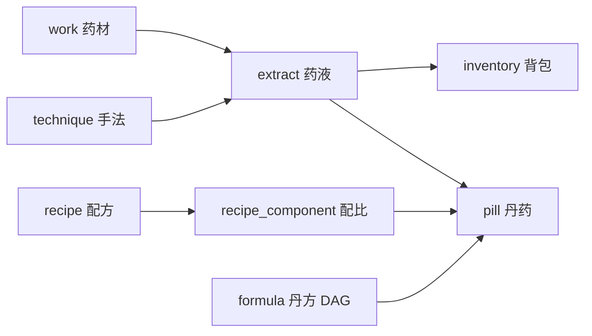

# 炼丹模型：把灵感引擎做成炼丹炉

> 设计稿 v0.1 ｜ 2026-11-11 ｜ 迁移：[006-alchemy.sql](inspiration/migrations/006-alchemy.sql) ｜ 示例配方：[recipes/](inspiration/recipes/)

## 0. 一页结论

你的比喻不是装饰，它准确命中了当前引擎缺的那一层：**中间物**。现在的 `work → observation → pattern → spec` 是一条直线，"炼化卡"是一张全息卡；但没有"把 A 的留白、B 的字阶、C 的反例各取一点，按比例合成"的能力。炼丹模型补的就是这一层。

| 丹道 | 系统概念 | 落点 |
| --- | --- | --- |
| 药材 | 作品 / 素材 / 片段 | `work` / `asset` / `fragment`（已有） |
| 火焰 | 模型 | `extract.fire_model`（qwen3-vl / gemini…） |
| 火候 | 模型 + 参数 + 提示词版本 | `technique.params_json` + `version` |
| 炼丹炉 | 引擎 | `ie` CLI + SQLite |
| 手法 | 可复用提示词模板 + 输出契约 | `technique.prompt_template` |
| 药液 | 单味药材 × 一种手法 的可复用中间物 | `extract` |
| 背包 | 收进自己库的药液 | `inventory` |
| 配方 | 维度组合 + 配比 + 合成模板 | `recipe` / `recipe_component` |
| 丹方 | 一次完整炼丹的流程（DAG） | `formula.steps_json` |
| 丹药 | 最终产物 + 成本 + 评分 | `pill` |

**这个比喻之所以成立**，是因为它本质上是「有向无环图 + 内容寻址 + 可重放构建」：药材可追踪、药液可缓存、配方可比较、丹方可重放。炼丹叙事给的是**可组合性**，工程要补的是**可验证性**。

## 1. 三个必须改的地方

### 1.1 一张图不是一味药，是十几味

如果按"一张图炼一瓶药液"，你永远做不出"取 A 的留白 + B 的字阶"。所以药液的粒度是 **维度**：色彩、字阶、间距、构图、材质、情绪、反例。同一张图可以被不同手法炼出多瓶药液，每瓶只装一件事。

### 1.2 配比必须结构化，不能只活在 prompt 里

"配比公式就是 prompt"听着顺，但**不可比较、不可优化、不可回放**。正确做法：`recipe_component` 存 `dimension + ratio`（0.5 / 0.3 / 0.15），`combination_prompt` 只是渲染模板，把配比和各药液内容填进去。

```text
模板：以 {{base.palette.ratio}} 的色彩语言为主，{{base.layout.ratio}} 的版式骨架，
      {{accent.type.ratio}} 的字阶作为强调；以下行为禁止：{{anti.donts.content}}
渲染：以 50% 的色彩语言为主，30% 的版式骨架，15% 的字阶作为强调……
```

### 1.3 丹药必须验，不能"炼出来就算成"

丹道的默认假设是"炼成即成功"，工程里这是最贵的错误。每颗丹药必须带：

- **配方合规**：相冲检查（见 §5）；
- **可复现**：丹方 + 种子 + 火候可重跑；
- **可评估**：重建测试 / 盲评 / 与配方目标的偏差。

## 2. 数据模型



关键约束：

- `extract` 唯一键 `(work, technique, dimension, fire_model)`：同一味药材、同一手法、同一口火候只炼一次；
- `extract.hash = sha256(work|technique|version|model|content)`：内容寻址，可缓存、可复现；
- `technique.version` 变了就重新炼，旧药液保留——**手法可迭代，药液不覆盖**；
- 药液质量 `quality ∈ [0,1]`，来源必须可解释（抽取置信度 / 与像素代理的一致性 / 人工复核）。

## 3. 手法规范

一条手法 = 一段模板 + 一个输出契约：

```json
{
  "key": "t.palette",
  "dimension": "palette",
  "prompt_template": "看图，只输出主色板：{{colors}} 与面积占比…",
  "schema_json": {"type": "object", "required": ["colors"]},
  "version": "1"
}
```

手法分三类：

| 类别 | 例子 | 特点 |
| --- | --- | --- |
| 观（observe） | 色板、字阶、间距、构图 | 可从图上直接量，质量高 |
| 悟（infer） | 情绪、隐喻、叙事 | 依赖模型判断，质量带不确定性 |
| 反（contrast） | 反例、禁忌 | 产出"不要做什么"，单独成液 |

`反` 类药液是配方里的"药引"：没有它，合成出来的东西会滑向平均值。

## 4. 配方与丹方

示例配方（[recipes/minimal-landing.recipe.json](inspiration/recipes/minimal-landing.recipe.json)）：

| slot | 维度 | 配比 | 必需 | 说明 |
| --- | --- | --- | --- | --- |
| base | palette | 0.50 | 是 | 定调 |
| base | layout | 0.30 | 是 | 定骨架 |
| accent | type | 0.15 | 否 | 局部强调 |
| anti | donts | 0.05 | 是 | 防同质化 |

丹方是 DAG（[recipes/brand-page.formula.json](inspiration/recipes/brand-page.formula.json)）：

```text
refine(A, t.layout)  ─┐
refine(A, t.palette) ─┼─> brew(recipe.minimal-landing) ─> render(spec) ─> pill
refine(B, t.type)    ─┘
```

`steps_json` 里每步只记 `op + inputs + technique/recipe`，不含自然语言——自然语言全在手法与配方的模板里，**流程本身必须可解析**。

## 5. 相冲检测（药性相冲）

配方不检查就合成，模型会把不兼容的东西硬凑。`recipe.constraints_json` 目前定义四条规则：

| 规则 | 判据 | 处置 |
| --- | --- | --- |
| 色板冗余 | 两瓶 palette 主色 hue 差 <15° 且明度差 <0.1 | 去掉低质量那瓶 |
| 对比不足 | 前景/背景对比 <4.5:1 | 报错，强制换 palette |
| 字阶冲突 | 两个 type 的基准字号比相差 >20% | 降权 0.5 或人工裁决 |
| 密度冲突 | 两瓶 layout 的留白率相差 >0.4 | 警告，建议只取其一 |

## 6. CLI

```sh
ie refine --work 7 --technique t.palette,t.layout,t.mood   # 炼药，入背包
ie bag                                                     # 看背包（v_bag）
ie recipe add docs/design/inspiration/recipes/minimal-landing.recipe.json
ie brew --recipe recipe.minimal-landing --material 7        # 用某件作品的药液炼丹
ie formula run docs/design/inspiration/recipes/brand-page.formula.json
```

## 7. 成本账本

`pill.cost_json = {model, tokens, ms}`。丹方可以先算预算再执行：每个 `refine` 步的成本可从历史 `extract` 均值估，`brew` 一步是大头。这回答"这颗丹多少钱"，而不是"感觉挺贵"。

## 8. 与现有系统的关系

| 现有 | 在丹道里的位置 |
| --- | --- |
| `observation` / `measure` / `work_primitive` | **化验结果**，不直接入药，用来给手法打质量分 |
| `distill` 炼化卡 | 一瓶"全息药液"，粒度太粗；炼丹模型把它拆成维度药液 |
| 303 条视觉标注 | 可以直接转成 `t.observe` 类药液，不必重炼 |

## 9. 里程碑

| 阶段 | 内容 | 验收 |
| --- | --- | --- |
| D0 | 迁移 006 + `ie refine`（palette / type 两个手法）+ `ie bag` | 能把 10 件作品炼成 20 瓶药液并在背包里查 |
| D1 | `ie brew` 单配方 + 相冲检测 | 合成 1 份规格，冲突能拦住 |
| D2 | `ie formula run` + 成本账本 | 丹方可重放，成本可报 |
| D3 | 丹药评测 | 重建测试 / 盲评接入，丹药带分数 |

## 10. 风险

| 风险 | 说明 | 对策 |
| --- | --- | --- |
| 维度爆炸 | 一张图十几瓶药液，背包很快失控 | 默认只炼必需维度；按质量聚合展示 |
| 药液质量参差 | 同一手法不同火候差别很大 | `fire_model` 强制记录，跨火候不可直接比较 |
| 组合幻觉 | 模型会把冲突配方硬凑 | 相冲规则前置，brew 前先跑检查 |
| 术语成本 | 丹道对工程师是负担 | 技术层保留英文表名，产品层用丹道叙事 |
| 配方僵化 | 所有丹药都出自少数配方，反而更同质 | 配方要能变异（配比扰动 ±10%）并保留版本 |

## 11. 待决

1. 药液维度定几类？（建议先 6：palette / type / layout / density / material / donts）
2. 质量分怎么算？现有可用的是抽取置信度与跨来源一致性，但两者都不完整。
3. "火候"是否允许混用？同一配方里 qwen 与 gemini 的药液混炼，风格会打架——建议一炉一火。
